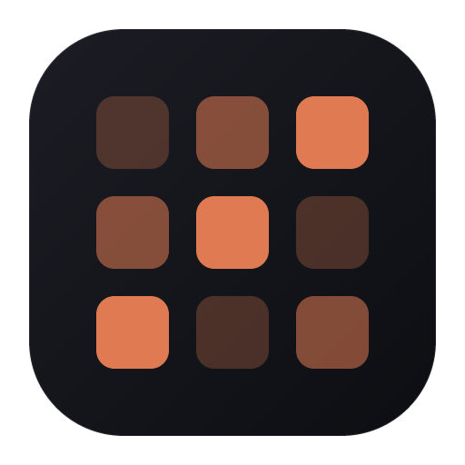
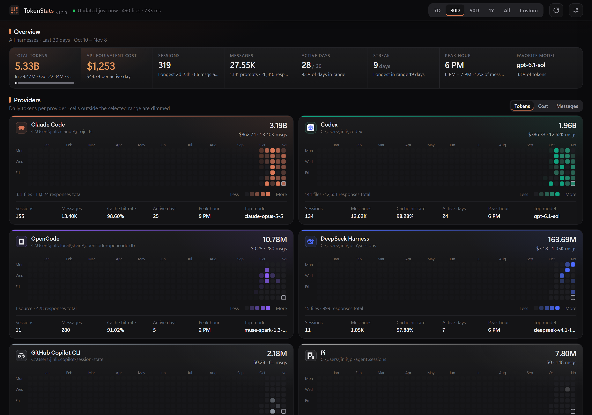

<p align="center">
  
</p>

<h1 align="center">TokenStats</h1>

<p align="center">
  Token usage and API-equivalent cost across every AI coding agent, in one local dashboard.
</p>

<p align="center">
  <a href="https://github.com/Panther114/TokenStats/releases/latest"></a>
  <a href="https://github.com/Panther114/TokenStats/releases"></a>
  
  
</p>

<p align="center">
  <a href="https://github.com/Panther114/TokenStats/releases/latest"><b>Download for Windows</b></a>
</p>

<p align="center">
  
</p>

## Features

- **18 harnesses:** Claude Code (including subagents), Codex, OpenCode, Gemini CLI, Qwen Code, GitHub Copilot CLI, DeepSeek Harness, Amp, Goose, Kimi CLI, Grok CLI and more, detected automatically.
- **Cost:** API-equivalent spend from public list prices, including cache rates and long-context tiers.
- **Insight:** contribution heatmaps, daily tokens or cost per harness, cache hit rates, streaks, peak hours and a sortable per-model table.
- **Ranges:** 7 days, 30 days, 90 days, 1 year, all time, or a custom date range.
- **Private:** reads local log files read-only; the only network request is an optional daily price refresh.

## Installation

Download `TokenStats_<version>_x64-setup.exe` from [Releases](https://github.com/Panther114/TokenStats/releases/latest) and run it. No administrator rights are required.

## Building from Source

```bash
pnpm install
pnpm tauri build
```

Provider adapters, data locations and pricing rules are documented in [`src-tauri/src/providers/`](src-tauri/src/providers/). Parsing and deduplication follow [ccusage](https://github.com/ccusage/ccusage); provider logos come from [lobe-icons](https://github.com/lobehub/lobe-icons) (MIT).
